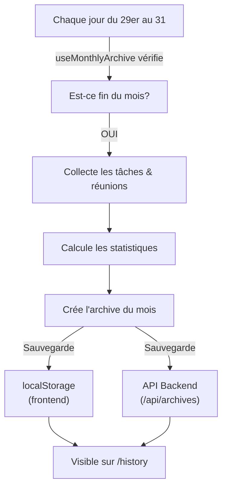

# 🎯 SYSTÈME D'HISTORIQUE COMPLET - RÉSUMÉ D'IMPLÉMENTATION

## ✅ Fichiers créés

### 1. **Librairies de gestion** (`lib/`)
- ✅ `historyStorage.ts` - Gestion du stockage et statistiques
- ✅ `useMonthlyArchive.ts` - Hook pour archivage automatique
- ✅ `demoData.ts` - Générateur de données de test

### 2. **API Backend** (`app/api/`)
- ✅ `app/api/archives/route.ts` - Route API pour archives

### 3. **Frontend** (`app/`)
- ✅ `app/history/page.tsx` - Page complète des statistiques avec Recharts
- ✅ `app/tasks/example-integration.tsx` - Exemple d'intégration

### 4. **Documentation**
- ✅ `HISTORY_SYSTEM.md` - Guide complet
- ✅ `SETUP.md` - Ce fichier

### 5. **Package.json**
- ✅ `recharts@^2.11.0` ajouté aux dépendances

---

## 🚀 POUR DÉMARRER MAINTENANT

### Étape 1 : Installez les packages (si pas déjà fait)
```bash
npm install
```

### Étape 2 : Testez la page History
1. Lancez l'application: `npm run dev`
2. Allez à `http://localhost:3000/history`
3. Cliquez sur "Charger les données de démonstration"
4. Explorez les graphiques et statistiques !

---

## 📊 FONCTIONNALITÉS IMPLEMENTÉES

### ✨ Page History (`/history`)
```
┌─────────────────────────────────────────────────┐
│  Historique et Statistiques                     │
├─────────────────────────────────────────────────┤
│  [Sélecteur de mois] Jan Feb Mar Apr ...       │
├─────────────────────────────────────────────────┤
│  
│  Taux accomplissement     │  Vitesse exécution  │
│  [Courbe verte]           │  [Courbe orange]    │
│  
│  Volume tâches            │  Réunions par mois  │
│  [Barres bleues/vertes]   │  [Barres violettes] │
│
│  Statistiques Détaillées du mois sélectionné
│  ┌─────────────┬──────────┬─────────┬──────────┐
│  │ Taux réussi │ Temps moy│ Tâches  │ Réunions │
│  │   85.5%     │   4.2 j  │   20    │    5     │
│  └─────────────┴──────────┴─────────┴──────────┘
│
│  [Tableau détaillé des tâches archivées]
│  [Tableau détaillé des réunions archivées]
│
└─────────────────────────────────────────────────┘
```

---

## 🔌 INTÉGRER AVEC VOS PAGES DE TÂCHES

### Option 1 : Simple (Recommandée)
Ajoutez à votre `TasksPage`:

```tsx
import { useMonthlyArchive } from "@/lib/useMonthlyArchive";

export default function TasksPage() {
  const [tasks, setTasks] = useState([...]);
  const [meetings, setMeetings] = useState([...]);

  // ✅ Une seule ligne pour l'archivage automatique !
  useMonthlyArchive(tasks, meetings);

  // ... votre code existant
}
```

### Votre structure de tâche doit être :
```tsx
{
  id: "task-1",
  title: "Titre de la tâche",
  status: "completed" | "pending" | "in-progress",
  assignedTo: "Nom technicien",
  createdDate: "2025-02-20",      // YYYY-MM-DD
  completedDate: "2025-02-23",    // optionnel
  daysToComplete: 3                // optionnel (auto-calculé)
}
```

### Structure des réunions :
```tsx
{
  id: "meeting-1",
  title: "Réunion d'équipe",
  date: "2025-02-20",              // YYYY-MM-DD
  duration: 60,                    // minutes
  participants: ["Céleste", "Junior"],
  notes: "Points clés..."          // optionnel
}
```

---

## 📈 STATISTIQUES AUTOMATIQUEMENT CALCULÉES

| Métrique | Calcul |
|----------|--------|
| **Taux réussite** | (tâches complétées / total) × 100 |
| **Temps moyen** | Σ daysToComplete / nb complétées |
| **Volume tâches** | Somme des tâches du mois |
| **Durée réunions** | Σ duration des réunions |

---

## ⚙️ ARCHIVAGE AUTOMATIQUE



---

## 🧪 DONNÉES DE DÉMONSTRATION

Cliquez sur **"Charger les données de démonstration"** pour :
- 6 mois d'historique
- 15-25 tâches par mois
- 3-8 réunions par mois
- Données réalistes et randomisées

---

## 🎨 PERSONNALISATION

### Modifier les couleurs
`app/history/page.tsx` ligne ~35:
```tsx
const COLORS = ["#10b981", "#f97316", "#ef4444", "#8b5cf6"];
```

### Modifier les mois affichés
`lib/demoData.ts` ligne ~108:
```tsx
for (let monthsBack = 1; monthsBack <= 6; monthsBack++)  // Changer 6 à 12 pour 1 an
```

### Modifier quand archiver
`lib/useMonthlyArchive.ts` ligne ~27:
```tsx
if ((now.getDate() >= 29 || now.getMonth() === 1) && ...)  // Changer 29 à autre jour
```

---

## 🔧 PROCHAINES ÉTAPES

- [ ] Connecter à une vraie base de données (PostgreSQL/MongoDB)
- [ ] Ajouter export PDF des statistiques
- [ ] Ajouter filtres par technicien sur /history
- [ ] Notifications quand archive créée
- [ ] Dashboard donut pour distribution par technicien
- [ ] Export Excel des données archivées

---

## 📞 BESOIN D'AIDE ?

Consultez :
- `HISTORY_SYSTEM.md` - Documentation complète
- `app/tasks/example-integration.tsx` - Exemple fonctionnel
- `lib/` - Code source annoté

